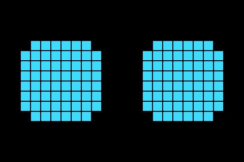
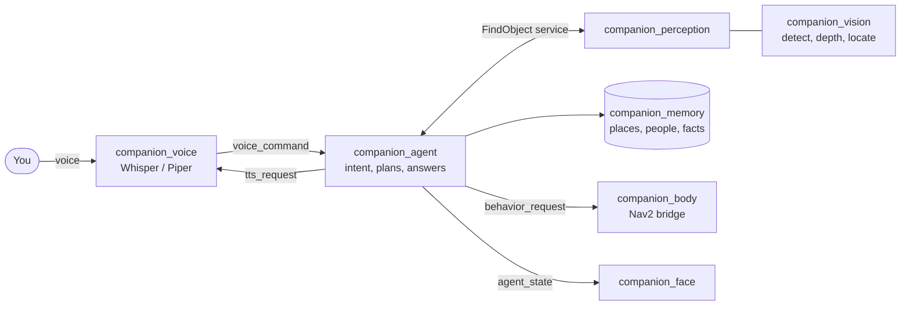

# Companion

**A ROS 2 robot brain that finds what you ask for. "Where is the mug?" gets an answer in
metres.**

Companion is the software for a small home robot. It listens to a command, decides what to do,
remembers places, people and facts, finds objects with its camera, and drives its body through
Nav2. Its eyes are open-vocabulary detectors (OWLv2 or Grounding DINO) plus depth, so it can
look for any object you name, with no training. It places that object in 3D and tells you where
it is.

It is built the way a team would build it:

- typed contracts between every node, checked in CI;
- a one-command Docker test gate;
- benchmarks on public datasets, with every number traceable to a result file;
- design decisions written down as ADRs.

## Results

Measured on public datasets with the robot's own code: see [docs/EVALUATION.md](docs/EVALUATION.md)
for the method and full tables.

| Question | Result |
|---|---|
| Does it find the object it was asked for? | **43.6 AP** (64.4 AP50) on all 5,000 COCO val2017 images, using the plain class names as queries (OWLv2) |
| Does it find household objects in real homes? | **77%** of 2,062 objects found on the NYU Depth V2 test split |
| Does it put them in the right place? | **5.4 cm** median 3D error with a depth camera; 86% of objects within 25 cm |
| Can a plain webcam do it? | 47 cm median error from monocular depth: the scale is off by a steady factor, so a one-off calibration is the fix ([roadmap](docs/ROADMAP.md)) |

## How it works

- **Perception is a ROS-free library** ([ADR 0002](docs/adr/0002-ros-free-vision-library.md)).
  The same code runs the robot, the benchmarks and the webcam demo.
- **Every miss is explained.** The `FindObject` service returns `no_match`, `no_depth`,
  `no_frame` or `bad_query`, and the robot says which, instead of guessing.
- **AI decides what; classical robotics decides how.** Models find objects, Nav2 plans paths,
  and the body's firmware drives the motors.

The full package graph is generated from the contract registry:
[docs/ARCHITECTURE.md](docs/ARCHITECTURE.md).

## Try it

| You want to | Run |
|---|---|
| Run every test exactly as CI does (needs Docker only) | `bash scripts/docker_verify.sh` |
| See detection on your webcam (GPU recommended) | `pip install -e "ros2_ws/src/companion_vision[models,demo]"` then `python -m companion_vision.demo --query mug` |
| Run the robot stack on Ubuntu 24.04 with ROS 2 Jazzy | `cd ros2_ws && colcon build && source install/setup.bash && ros2 launch companion_bringup desktop_dev.launch.py` |

Details for each path: [docs/SETUP.md](docs/SETUP.md).

## What runs where

| Environment | What runs | Evidence |
|---|---|---|
| Docker, every pull request | The full ROS 2 stack: build, lint, unit tests, launch tests and architecture validators | [CI](https://github.com/xDarkzx/Companion/actions/workflows/ci.yml), `scripts/docker_verify.sh` |
| Desktop GPU (RTX 5070) | Real models: benchmarks, model smoke tests, webcam demo | [`eval/results/`](eval/results) |
| MentorPi (Pi 5, lidar, RGB-D camera) | Reference body with launch files and topic names | [docs/HARDWARE.md](docs/HARDWARE.md), next milestone on the [roadmap](docs/ROADMAP.md) |

## Engineering

- **Contracts in CI.** Every topic and service is registered with its type and owners. Validators
  fail the build on anything undocumented, mistyped or unwired, and the architecture diagram is
  generated from the same registry.
- **Tests that can't be gamed.** 200+ ROS tests, including launch tests that run real nodes and
  assert the exact sentence the robot speaks. A test-honesty validator rejects `assert True`,
  skipped tests and launch tests that don't wait for discovery.
- **Measured, not demoed.** Benchmark scripts write result files with model revisions, settings
  and commit. The evaluation tables are generated from those files, and CI checks they match.
- **Fail loudly.** A model that can't load stops its node with exit code 1. There are no silent
  fallbacks.
- **Licences checked.** Only Apache-2.0, MIT or BSD code and weights
  ([ADR 0003](docs/adr/0003-permissive-licences-only.md)); the AGPL YOLO dependency was removed.
- **Process.** Protected `main`, pull requests, conventional commits, a changelog, ADRs, a
  secret scan of the full history, and Dependabot.

## Documentation

| Read | For |
|---|---|
| [docs/REVIEWING.md](docs/REVIEWING.md) | A ten-minute guided tour for reviewers |
| [docs/ARCHITECTURE.md](docs/ARCHITECTURE.md) | Packages, contracts, request flows, where AI is and isn't used |
| [docs/PERCEPTION.md](docs/PERCEPTION.md) | The vision pipeline, ROS interface and parameters |
| [docs/EVALUATION.md](docs/EVALUATION.md) | Benchmarks, results and how to reproduce them |
| [docs/TESTING.md](docs/TESTING.md) | Test tiers and what each test proves |
| [docs/HARDWARE.md](docs/HARDWARE.md) | Reference body, Pi deployment, voice hardware |
| [docs/adr/](docs/adr/README.md) | Design decisions |
| [docs/ROADMAP.md](docs/ROADMAP.md) | What's next |

## Licence

[Apache-2.0](LICENSE). Model weights are downloaded at runtime under their own licences, all
Apache-2.0 ([ADR 0003](docs/adr/0003-permissive-licences-only.md)).
