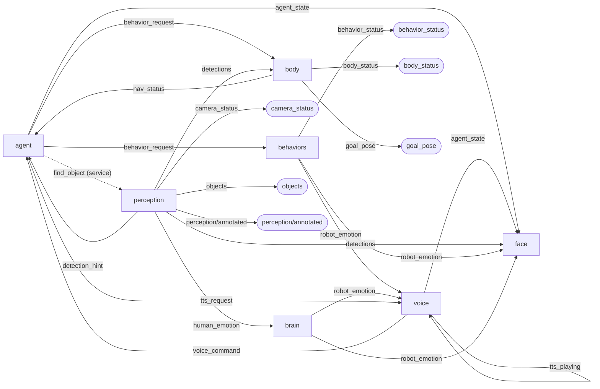
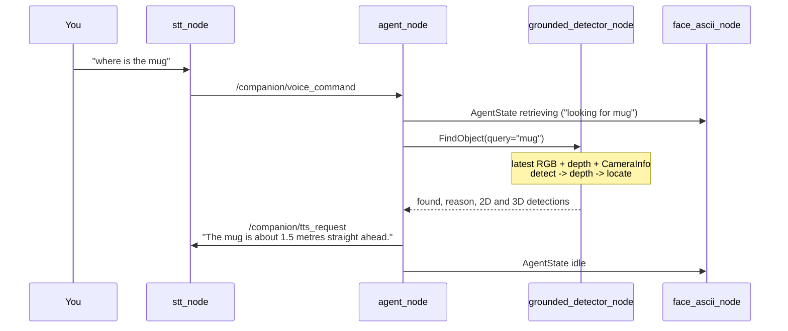

# Architecture

Companion is the software brain of a small home robot: it listens, decides, remembers, looks,
and drives a body through Nav2. The brain runs on a Raspberry Pi 5 or a desktop. The body is
swappable: the code targets the Hiwonder MentorPi (four-wheel base with lidar and an RGB-D
camera) as its reference body profile, and a body is just the nodes that turn goals into motion.

## Principles

1. **Nodes talk only through typed contracts.** Every topic and service is registered with its
   type and the packages allowed to use it ([ADR 0001](adr/0001-ros2-jazzy-python-typed-contracts.md)).
   CI fails on anything undocumented, mistyped or unwired, and the graph below is generated from
   that same registry.
2. **AI decides what, classical robotics decides how.** Models find objects and interpret
   commands; Nav2 plans paths; the body's firmware drives motors. No model output reaches a
   motor directly.
3. **Every miss is explained.** Services return a reason (`no_match`, `no_depth`, `no_frame`, ...),
   and a model that cannot load stops the node instead of degrading quietly.
4. **Small, single-purpose files.** 500-line target, 800-line hard cap enforced in CI.

## Package graph

Solid arrows are topics, dotted arrows are services, rounded boxes are outputs for tools such as
Foxglove or RViz. Generated by `python tools/gen_architecture_diagram.py` from
[`tools/companion_contracts.py`](../tools/companion_contracts.py).

<!-- diagram:start -->

<!-- diagram:end -->

## Packages

| Package | Responsibility | Key files |
|---|---|---|
| `companion_interfaces` | Message and service contracts | `msg/*.msg`, `srv/FindObject.srv` |
| `companion_agent` | Turns a sentence into a plan, an answer or a memory | `agent_node.py`, `parse_command.py`, `find_intent.py`, `object_answer.py` |
| `companion_memory` | Places, people and learned facts; keyword retrieval for the agent | `places_store.py`, `fact_store.py` (bounded SQLite), `rag_retriever.py` |
| `companion_vision` | ROS-free perception: detect by name, estimate depth, locate in 3D ([ADR 0002](adr/0002-ros-free-vision-library.md)) | `detector.py`, `depth.py`, `localize.py`, `pipeline.py` |
| `companion_perception` | ROS adapter for the vision library, camera health, follow hints | `grounded_detector_node.py`, `ros_convert.py` |
| `companion_behaviors` | Maps behaviours to emotions; patrol animation | `behavior_controller_node.py` |
| `companion_body` | Nav2 goals for places, follow and patrol; body status | `nav_bridge_node.py`, `motion_controller.py` |
| `companion_brain` | Personality and the empathy rules | `empathy_node.py`, `human_to_robot.py` |
| `companion_face` | Animated pixel-eye face with sound effects | `face_ascii_node.py`, `ascii_renderer.py` |
| `companion_voice` | Speech in (Whisper or keyboard) and out (Piper or espeak-ng) | `stt_node.py`, `tts_node.py` |
| `companion_bringup` | Launch files, configuration and the cross-node integration tests | `launch/`, `config/`, `test/` |

## Request flows

### "Where is the mug?"

Perception keeps only the newest frame from each camera topic, so a slow model never builds a
backlog: a query always answers from the latest image. If the service is down or slow, the
agent's client times out after `find_timeout_sec` (default 3 s) and the robot says it cannot
check its camera.

### "Go to the kitchen and patrol"

1. `parse_command` turns the sentence into a plan: `go_to_place kitchen`, then `patrol`.
2. The agent publishes the first `BehaviorRequest`. `nav_bridge_node` looks the kitchen up in
   `config/places.yaml` and sends a Nav2 goal; `behavior_controller_node` sets the face to happy.
3. The agent waits for `arrived` on `/companion/nav_status` before sending `patrol`. "Stop"
   cancels the plan and the goal in flight.

### "Remember that the garage code is 4455"

The fact goes into a bounded SQLite store. A later question ("what is the garage code") is
matched by keyword retrieval over places, people and facts. The agent publishes the retrieval on
`AgentState` (`rag_used`, `memory_count`) so the face can show it is recalling, and answers from
the stored fact. Replies come from templates by default; a local Ollama model can be enabled to
phrase them more naturally (`llm_provider: ollama`).

## Where AI is used, and where it deliberately is not

| Decision | How | Why |
|---|---|---|
| Is the mug in view, and where? | OWLv2 or Grounding DINO plus depth | Open vocabulary: no training per object |
| How far away is it? | Depth camera, or monocular depth when there is none | Measured in [EVALUATION.md](EVALUATION.md) |
| What does the sentence ask for? | Rule-based grammar | Predictable, testable, no model needed for a fixed command set |
| How do I get to the kitchen? | Nav2 | Proven planners; safety is not a learning problem |
| How should the reply sound? | Templates, optional local LLM | The robot must work offline and answer the same way every time |
