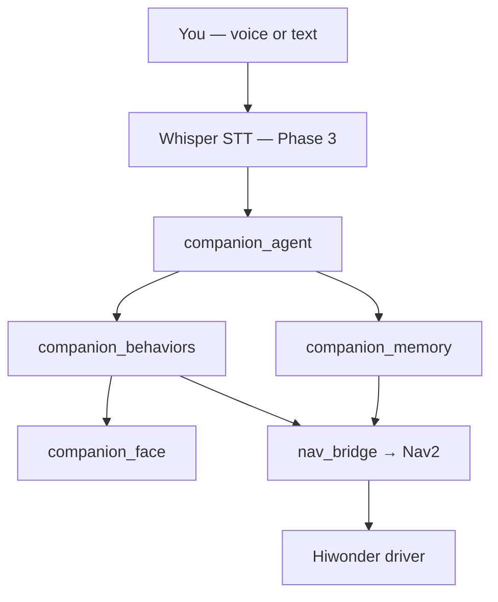

# Companion — Human Interface

Companion is the **main interface between you and the robot**. It understands
commands, remembers names and places, drives personality (face + voice), and
tells Nav2 / the body what to do. Vendor firmware moves wheels; **Companion
decides why.**

See also:

- [ENTERPRISE_STACK.md](ENTERPRISE_STACK.md) — full tech layers
- [DEPLOY_MENTORPI.md](DEPLOY_MENTORPI.md) — Pi + MentorPi setup
- [VISION_AND_HAILO.md](VISION_AND_HAILO.md) — AI vision on the Hailo hat
- [MEMORY_AND_RAG.md](MEMORY_AND_RAG.md) — memory tiers, RAG state, cloud face badge
- [VOICE_HARDWARE.md](VOICE_HARDWARE.md) — USB mic/speaker, Whisper STT, WonderEcho Pro

---

## Architecture



---

## Command flow (example)

**You say:** “Go to the kitchen and patrol.”

| Step | Component | Action |
|------|-----------|--------|
| 1 | STT (future) | Text → `/companion/voice_command` |
| 2 | `companion_agent` | Parses **plan**: `[go_to_place kitchen, patrol]` |
| 3 | `companion_memory` | Looks up **kitchen** in `places.yaml` |
| 4 | `companion_behaviors` | Emotion **happy** → then **patrol** + animation cycle |
| 5 | `nav_bridge_node` | Publishes `/goal_pose` for kitchen |
| 6 | Nav2 (vendor) | Drives there, avoids obstacles |
| 7 | After delay / arrival | Agent publishes second step: **patrol** |
| 8 | `companion_face` | Cycles neutral → surprise → happy while patrolling |

---

## Memory

### Named places (`config/places.yaml`)

Teach once after SLAM mapping:

```yaml
places:
  kitchen:  { x: 3.2, y: 1.1, yaw: 1.57 }
  bedroom:  { x: -1.0, y: 4.5, yaw: 0.0 }
  dock:     { x: 0.0, y: 0.0, yaw: 0.0 }
```

**How to fill in:** drive robot in RViz, click Nav2 goal at the kitchen, copy coordinates.

### People (`config/people.yaml`) — Phase 3

```yaml
people:
  dan:
    note: "Primary owner"
```

Future: face embedding ID, voice profile, bond level.

---

## Supported commands (today)

| Command | Behavior |
|---------|----------|
| `follow me` | Follow person (Nav2 dynamic follow, Phase 3) |
| `patrol` / `patrol the home` | Waypoint / random patrol + **face animation cycle** |
| `go to kitchen` | Navigate to named place |
| `go to kitchen and patrol` | **Sequence**: kitchen → patrol |
| `play with the dog` | Playful dog chase (YOLO + follow, Phase 3) |
| `go home` | Navigate to `dock` or `home` in places.yaml |
| `stop` | **Immediate** — clears plan, idle face |

---

## Command priority

1. **stop** — always wins, cancels queued steps
2. **New command** — replaces current plan
3. **Patrol / follow** — run until stop or low battery (future)

---

## Patrol animations

While `patrol` is active, `behavior_controller_node` cycles face emotions
(configurable in `config/stack.yaml`):

```yaml
behavior_controller_node:
  ros__parameters:
    patrol_emotions: [neutral, surprise, happy, neutral]
    patrol_animation_sec: 2.5
```

Body motion = Nav2. Personality = Companion.

---

## ROS topics & messages

| Topic | Type | Role |
|-------|------|------|
| `/companion/voice_command` | `std_msgs/String` | Raw text in |
| `/companion/behavior_request` | `BehaviorRequest` | Agent → behaviors |
| `/companion/robot_emotion` | `RobotEmotion` | Face + SFX |
| `/companion/behavior_status` | `std_msgs/String` | e.g. `active:patrol` |
| `/companion/agent_state` | `AgentState` | agent | face, logs |
| `/goal_pose` | `geometry_msgs/PoseStamped` | nav_bridge | Nav2 |

### BehaviorRequest fields

| Field | Example | Meaning |
|-------|---------|---------|
| `behavior` | `go_to_place` | What to do |
| `target` | `kitchen` | Named place |
| `source` | `voice` | Who sent it |
| `intensity` | `0.85` | Playfulness / ardor |

---

## Try it (no microphone)

```bash
ros2 launch companion_bringup companion_stack.launch.py
```

Terminal 2:

```bash
ros2 topic pub /companion/voice_command std_msgs/msg/String \
  "{data: 'go to kitchen and patrol'}" --once

ros2 topic echo /companion/robot_emotion
ros2 topic echo /goal_pose
```

You should see a kitchen goal pose, then patrol emotions cycling.

---

## Packages

| Package | Role |
|---------|------|
| `companion_agent` | Parse commands, multi-step plans |
| `companion_memory` | Load places.yaml / people.yaml |
| `companion_behaviors` | Emotions + patrol animations |
| `companion_body` | `nav_bridge_node` → `/goal_pose` |
| `companion_face` | LCD / ASCII face |
| `companion_brain` | Personality, empathy (MOAT) |

---

## Roadmap hooks

| Phase | Adds |
|-------|------|
| **3** | Whisper STT, Nav2 action feedback (wait for arrival before step 2), YOLO |
| **3b** | NASA ROSA replaces simple parser for free-form speech |
| **4** | Learn new place names from conversation, fine-tune detection |

---

## What Companion is NOT

- **Not** motor firmware — Hiwonder `driver`
- **Not** obstacle avoidance — Nav2 + lidar
- **Not** Isaac Lab training — stock Nav2 handles driving

Companion is the **butler**: remembers **kitchen**, obeys **go there and patrol**,
and makes the face look alive while the car drives.
