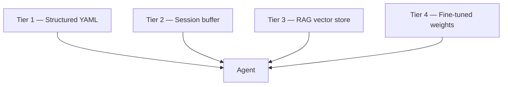
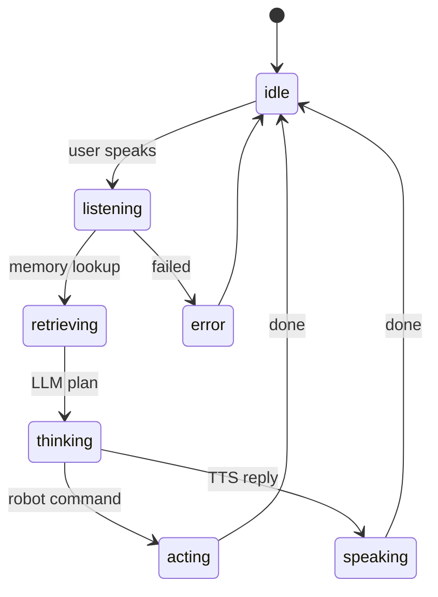

# Memory & RAG — how Companion remembers

Companion must **remember names, places, and conversations** and show you when
it is **thinking / searching memory / talking to the cloud** (Emo-style).

This doc defines the **memory tiers**, **RAG state machine**, and **face overlay**.

Related: [HUMAN_INTERFACE.md](HUMAN_INTERFACE.md) · [VISION_AND_HAILO.md](VISION_AND_HAILO.md)

---

## Design principle

**Memory and motion stay separate.**

| System | Remembers | Drives motors |
|--------|-----------|---------------|
| YAML places/people | ✅ | ❌ |
| RAG vector store | ✅ | ❌ |
| ChatGPT / Ollama | ✅ (session + tools) | ❌ |
| Nav2 | Map only | ✅ |

The LLM **never** publishes `/cmd_vel`. It calls **tools** that publish
`BehaviorRequest` or update memory.

---

## Memory tiers (four layers)



| Tier | What | Status | Example |
|------|------|--------|---------|
| **1 — Structured** | `places.yaml`, `people.yaml` | ✅ **Now** | "kitchen" → map pose |
| **2 — Session** | Last N chat turns in RAM | Phase 3 | "you said patrol 2 min ago" |
| **3 — RAG** | Embeddings over facts/episodes | Phase 3/4 | "Dan prefers kitchen patrol at night" |
| **4 — Fine-tune** | Custom model weights | Phase 4 | Better dog detection, voice |

**Tier 1** is not "fake RAG" — it is the **source of truth** for places and people.
Vector RAG **augments** it; it does not replace it.

---

## RAG state machine (always explicit)

Every conversational turn publishes **`AgentState`** on `/companion/agent_state`.
Nothing happens "silently" — the face and logs always know what the brain is doing.



### AgentState message

| Field | Meaning |
|-------|---------|
| `state` | `idle`, `listening`, `retrieving`, `thinking`, `speaking`, `acting`, `error` |
| `provider` | `none`, `ollama`, `openai` |
| `rag_used` | `true` if memory chunks were injected this turn |
| `memory_count` | How many chunks (place/person/RAG docs) |
| `status_text` | Short line on face subtitle, e.g. `place:kitchen` |

### Try it

```bash
ros2 launch companion_bringup companion_stack.launch.py
ros2 topic pub /companion/voice_command std_msgs/msg/String \
  "{data: 'go to kitchen and patrol'}" --once
ros2 topic echo /companion/agent_state
```

You should see: `listening` → `retrieving` → `thinking` → `acting` → `idle`.

---

## Face overlay (Emo-style cloud indicator)

When `state` is `retrieving`, `thinking`, or `speaking`:

- Eyes widen (`surprise` mood)
- **Cloud badge** — pulsing blue dots, top-right (Companion-branded)
- **Status line** — e.g. `place:kitchen` at bottom

### Why not the ChatGPT logo?

Emo shows a **cloud icon when the cloud brain is active** — the UX pattern is:
*"I'm thinking off-device."*

For Companion we use a **Companion cloud badge** (three pulsing dots), not the
OpenAI trademark, unless you deliberately want API co-branding later.

When `llm_provider: openai` in `stack.yaml`, the badge indicates **cloud LLM
active** — same user feeling, your own character.

---

## RAG pipeline (Phase 3 full)

```
User speech
    ↓ Whisper STT
/companion/voice_command
    ↓
companion_agent
    ↓ retrieve_context()  ← Tier 1 YAML today, + vector DB later
    ↓ LLM (OpenAI / Ollama / ROSA) with injected chunks
    ↓ tool calls: go_to_place, patrol, remember_fact
/companion/behavior_request  +  TTS
    ↓
Nav2 + face + memory write-back
```

### What gets stored in RAG (Phase 3/4)

| Memory type | Stored as | Retrieved when |
|-------------|-----------|----------------|
| Place alias | Tier 1 YAML | "go to kitchen" |
| Person name | Tier 1 YAML → Tier 3 | "that's Dan" |
| Preferences | Tier 3 vector | "patrol at night" |
| Episodes | Tier 3 + rosbag | "last time you said stop" |

### Write-back example

**You:** "Remember the kitchen is where we eat."

Agent tool `remember_fact` → append to RAG index + optional YAML note.

---

## LLM providers

Configure in `config/stack.yaml`:

```yaml
agent_node:
  ros__parameters:
    llm_provider: none    # none | ollama | openai
```

| Provider | When | Face shows cloud badge |
|----------|------|------------------------|
| `none` | Rule parser only (now) | During retrieve/think stub |
| `ollama` | Local Pi LLM | During think/speak |
| `openai` | ChatGPT API | During think/speak |

Phase 3b: [NASA ROSA](https://github.com/nasa-jpl/rosa) wraps tools; same
`AgentState` + memory injection.

---

## Implementation map

| Component | File / package |
|-----------|----------------|
| AgentState msg | `companion_interfaces/msg/AgentState.msg` |
| State constants | `companion_memory/rag_state.py` |
| YAML retrieval | `companion_memory/rag_retriever.py` |
| State publisher | `companion_agent/agent_node.py` |
| Cloud badge | `companion_face/ascii_renderer.py` |
| Vector RAG | `companion_memory/` Phase 3 (chromadb / sqlite) |
| Session buffer | `companion_agent/` Phase 3 |

---

## What "remember" means at each phase

| Phase | Can remember |
|-------|----------------|
| **Now** | Place names, people names in YAML; shows RAG state on face |
| **3** | Session chat, OpenAI/Ollama replies, Nav2 places |
| **3/4** | Facts, preferences, episodes via vector RAG |
| **4** | Fine-tuned models + continuous learning pipeline |

---

## Rules (non-negotiable)

1. **Always publish `AgentState`** — no silent LLM calls.
2. **Structured memory wins** — if YAML says kitchen at (3.2, 1.1), RAG cannot override coordinates without confirmation.
3. **Stop always wins** — memory/LLM cannot block emergency stop.
4. **Log RAG turns** — rosbag for Phase 4 fine-tune (input, chunks, action, outcome).

---

## One sentence

**Companion remembers in layers (YAML → session → RAG → fine-tune), always shows
you its brain state on the face, and uses ChatGPT/Ollama only as the language
layer — never as the motor driver.**
