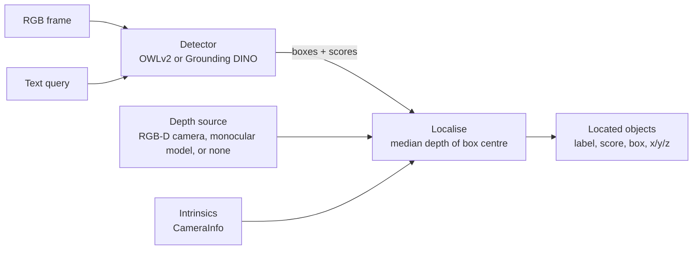

# Perception: finding objects by name

Ask "where is the red mug?" and Companion:

1. finds the mug in the latest camera image;
2. measures how far away it is;
3. places it in 3D in the camera frame;
4. answers in plain words.

No training is needed for a new object. The detectors are open-vocabulary: any phrase is a
valid query.

## Pipeline

| Stage | Module | Behaviour worth knowing |
|---|---|---|
| Detect | [`detector.py`](../ros2_ws/src/companion_vision/companion_vision/detector.py) | Queries are trimmed, lowercased and de-duplicated, and an empty query is rejected. Results go through one score threshold, per-label NMS and a top-k cap. A backend that cannot load raises `DetectorLoadError` and never falls back silently. |
| Depth | [`depth.py`](../ros2_ws/src/companion_vision/companion_vision/depth.py) | Accepts `16UC1` millimetres or `32FC1` metres from a depth camera, or estimates metric depth from RGB. Depth is computed only when something was detected. |
| Locate | [`localize.py`](../ros2_ws/src/companion_vision/companion_vision/localize.py) | Takes the median over the central half of the box, so wall pixels at the edges don't pull the estimate. Zero, NaN and out-of-range readings are ignored. Too few valid pixels gives no position rather than a guess. Depth at a different resolution is resized with nearest-neighbour sampling, so no values are invented. |
| Pipeline | [`pipeline.py`](../ros2_ws/src/companion_vision/companion_vision/pipeline.py) | Returns results best first, with per-stage timings. |

Positions use the ROS optical frame (REP 103): x right, y down, z forward, in metres.

## ROS interface

`grounded_detector_node` (package `companion_perception`) wraps the library:

| Interface | Type | Notes |
|---|---|---|
| `/companion/find_object` | `companion_interfaces/srv/FindObject` | Answers from the latest frame. `reason` is one of `ok`, `no_match`, `no_depth`, `no_frame`, `bad_query`. |
| `/companion/objects` | `vision_msgs/Detection3DArray` | Matches that have a 3D position. |
| `/companion/perception/annotated` | `sensor_msgs/Image` | The frame with boxes, for Foxglove or RViz. |
| `/companion/detections` | `companion_interfaces/DetectionBatch` | The watch list (`person`, `dog` by default) for follow and play hints. |

| Parameter | Default | Meaning |
|---|---|---|
| `backend` | `owlv2` | `owlv2`, `grounding_dino`, or `fake` (tests only) |
| `device` | `auto` | `cuda` when PyTorch sees a GPU, otherwise `cpu` |
| `depth_mode` | `sensor` | `sensor` (RGB-D camera), `monocular`, or `none` |
| `score_threshold` | `0.2` | Minimum detection score |
| `watch_labels` | `[person, dog]` | Labels checked continuously for behaviour hints |
| `watch_rate_hz` | `2.0` | How often the watch list runs; lower it on a CPU-only Pi |
| `rgb_topic`, `depth_topic`, `camera_info_topic` | MentorPi camera topics | Point these at any camera |

The node keeps only the newest frame from each topic. A model slower than the camera therefore
never builds a backlog, and every answer reflects the latest image.

## Choosing models

Both detectors and the depth model are Apache-2.0 licensed and pinned to a revision
([ADR 0003](adr/0003-permissive-licences-only.md)). The default detector was chosen from the
benchmarks ([ADR 0004](adr/0004-default-detector.md)), and the measured accuracy and speed are
in [EVALUATION.md](EVALUATION.md).

Monocular depth gets the shape of a room right, but on a camera it was not trained for, the
absolute scale can be off by a steady factor. On NYU the factor is about 0.87 (truth ÷
estimate). That is why the robot defaults to its depth camera, and why monocular distances in
the webcam demo are approximate.
