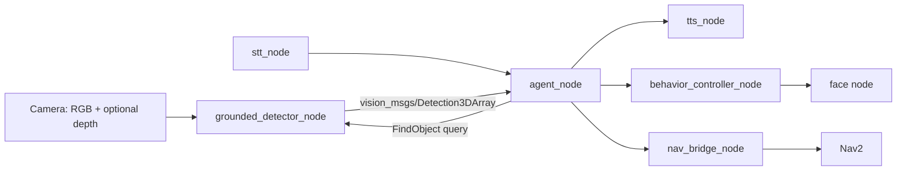

# Companion v0.1: grounded perception and public release

Date: 2026-10-14. Status: awaiting review.

## 1. Purpose

Companion becomes the public robotics portfolio repo for an AI engineer aiming at AI-vision and
robotics roles. A reviewer must be able to judge the author's ability accurately in about ten
minutes: what the system does, how it is built, how it is tested, and how well its AI parts
actually perform, with every claim backed by something they can run or read.

Two goals, in priority order:

1. **Show AI vision on a robot stack.** Add language-driven perception: the robot is asked "where
   is the red mug?", finds it in the camera image, works out where it is in 3D, and answers. It is
   measured on public labelled datasets.
2. **Present the existing work professionally.** About 5,900 lines across ten ROS 2 Jazzy
   packages (agent, voice, memory, navigation bridge, face, behaviours) are already written. They
   get a green quality gate, CI, clear documentation and a clean public history.

Success means: CI is green on every pull request, the README shows the system working (GIFs, a
diagram, a results table) without the reader installing anything, a reviewer can reproduce the
test suite with one Docker command, and every number in the README comes from a committed script
and its committed output.

## 2. Where the code is today (measured 2026-10-14)

Measured in a clean `ros:jazzy-ros-base` container:

| Gate | Result |
|---|---|
| `colcon build`, 10 packages | Clean |
| `colcon test` | 183 tests, 179 pass, 4 fail: 3 lint (import order and docstrings in `companion_face` and `companion_voice`) and 1 integration (`test_remember_fact_flow`) |
| Architecture validators (`tools/`) | 22 pass, 2 fail: topic `/companion/tts_playing` is used but missing from the contract registry |
| `ruff` | Fails: the ruff version is unpinned, and a newer release flags 332 issues |
| 800-line file guard | Passes |

Also in the working tree:
- **Uncommitted work:** 166 changes, including four whole packages.
- **Third-party material that must not be published:** stock-art files in the repo root (`*.jpg`, `*.ai`, `*.eps` and about 25 face PNGs), `reference/` (212 MB of other projects), `extracted_faces/`, downloaded `models/`, and a stray file named `=1.21.6,`.
- **Conflicting body descriptions:** the README says Freenove Robot Dog, while the code and newer docs target the Hiwonder MentorPi.
- **AGPL dependency:** perception uses Ultralytics YOLO, which is AGPL-3.0 and conflicts with publishing the repo under a permissive licence.

## 3. Scope

**In scope**
- Repo hygiene and a green gate.
- The `companion_vision` library and its ROS integration.
- Wiring the agent to answer "where is X" questions.
- An evaluation harness with committed results.
- Documentation, demo media, CI and the GitHub release.
- Optional: a bring-up on the author's own Raspberry Pi 5.

**Out of scope, recorded in the roadmap**
- **Sensing human emotion.** Facial emotion recognition is scientifically contested and restricted under the EU AI Act, so it is deferred until it can be designed carefully.
- **Fine-tuning and training.**
- **Hailo acceleration.**
- **Driving a physical body:** no body is owned yet.
- **A web dashboard.** Visualisation uses Foxglove instead.

## 4. Design

### 4.1 Architecture

Nodes talk only through typed messages. The contract registry
(`tools/companion_contracts.py`) stays the single source of truth for the topic graph.
`docs/ARCHITECTURE.md` gets a diagram generated from that registry, and CI fails if the diagram
and the registry drift apart.

### 4.2 `companion_vision`: a ROS-free perception library

A plain Python package. It imports no `rclpy`, so it can be tested quickly in isolation and run
natively on Windows with CUDA for evaluation and demos. It contains four units:

| Unit | Responsibility |
|---|---|
| `detector.py` | A `Detector` protocol: an RGB image plus text queries in, scored boxes out. Two backends: OWLv2 (`google/owlv2-base-patch16-ensemble`) and Grounding DINO tiny (`IDEA-Research/grounding-dino-tiny`), both through Hugging Face `transformers` and pinned to commit hashes. |
| `depth.py` | A `DepthSource` protocol. `SensorDepth` uses an aligned depth image from an RGB-D camera. `MonocularDepth` estimates metric depth with Depth Anything V2 Metric Indoor Small. |
| `localize.py` | Pure maths: turns a box, a depth map and pinhole intrinsics into a 3D point in the camera frame. It uses the median depth of the central 50% of the box, so background pixels at the box edges do not pull the estimate. Boxes without valid depth are reported as "no depth", never guessed. |
| `pipeline.py` | Combines detector, depth and localiser into `find(image, query) -> list[Located]`. |

Only Apache-2.0 or MIT model weights are used. Each licence is checked on the model card before
adoption and recorded in an ADR. If no permissively licensed metric depth model exists, the
monocular path is dropped and only sensor depth is supported. Ultralytics is removed, and an ADR
records why.

### 4.3 ROS integration

- **`grounded_detector_node`** in `companion_perception`:
  - **Inputs:** subscribes to RGB, and to depth plus `CameraInfo` when available.
  - **Queries:** serves `companion_interfaces/srv/FindObject` (a text query in; located objects out).
  - **Outputs:** publishes `vision_msgs/Detection3DArray` on `/companion/objects`, plus an annotated image for Foxglove.
  - **Robustness:** it keeps only the latest frame and runs inference only when a query arrives or the optional watch list is set, so a slow GPU or CPU never builds up a backlog.
- **The old YOLO `detector_node` and `DetectionBatch`** are replaced. Every consumer of `/companion/detection_hint` is moved to the new topic, and the contract registry is updated.
- **The agent** gets a "where is / find the X" intent. It calls `FindObject` and answers through TTS in plain words ("The red mug is about 1.2 metres ahead, a little to the left"). It sets the face to curious while searching, then happy or confused depending on the result.

### 4.4 Evaluation (`eval/`)

Each evaluation is run by a script that writes JSON and a Markdown table into `eval/results/`.
Datasets and caches are downloaded to `D:` and never committed. Model revisions and seeds are
recorded.

| Question | Data | Metrics |
|---|---|---|
| How well does it find named objects? | COCO val2017, all 5,000 images, with class names as text queries | AP and AP50 using `pycocotools`. These are checked against the published zero-shot figures to confirm the harness is correct. |
| How accurate are the 3D positions? | NYU Depth V2 labelled set, official 654-image test split, household classes | Median 3D error in cm and the share of objects within 10 cm and 25 cm. Compared against the ground-truth position, with sensor depth and with monocular depth. Monocular depth is also scored with AbsRel and δ1. |
| Is it fast enough for a robot? | 200 fixed frames | Latency per stage (p50 and p95) on an RTX 5070 GPU, on the desktop CPU, and on a Raspberry Pi 5 CPU if milestone M8 runs |

The README reports the numbers as measured, chooses the default backend from them (recorded in an
ADR), and includes a failure gallery taken from the author's own webcam captures. COCO and NYU
images are not redistributed.

### 4.5 How the repo presents itself

- **README order:** a hero GIF (the face reacting while the overlay finds an object), a one-paragraph pitch, the architecture diagram, the results table, a "What runs where" table, a quickstart for three audiences (read, run the tests in Docker, develop), and links to the rest.
- **`docs/REVIEWING.md`:** a ten-minute guided tour for reviewers that names the files worth reading.
- **Docs:** the 13 existing docs are consolidated into a coherent set: `ARCHITECTURE`, `PERCEPTION`, `EVALUATION`, `TESTING`, `HARDWARE`, `ROADMAP` and ADRs in `docs/adr/`. Working notes such as `REPLIES.md` are dropped.
- **Hardware story:** the MentorPi is described as the reference body profile the code targets, and the "What runs where" table says exactly what is tested where. No hardware claim is made beyond what has actually been run.
- **Standard files:** `LICENSE` (Apache-2.0), `CHANGELOG`, `CONTRIBUTING`, `SECURITY`, issue and PR templates, and `CODEOWNERS`.

### 4.6 Quality gates and process

- **CI, ROS job:** runs on GitHub Actions in a `ros:jazzy` container. It runs the build, `colcon test` (lint, unit and integration), the line guard, the architecture validators and the diagram-sync check.
- **CI, Python job:** runs `companion_vision` tests on CPU with fake backends. No model download is needed, so it is fast and deterministic.
- **Model smoke tests:** tests marked `models` load the real weights and run locally only.
- **Tooling:** ruff is pinned in `requirements-dev.txt` and in `pre-commit`. Dependabot covers pip and Actions.
- **Process:** `main` is protected. Changes go through pull requests with conventional commits, and a v0.1.0 release has notes.
- **History:** the existing commits are kept. The uncommitted work is committed in logical, per-package commits. Third-party files are removed from history before the first push.

## 5. Milestones

Each milestone ends with the full gate green.

| # | Milestone | Done when |
|---|---|---|
| M1 | Hygiene and green gate | WIP committed in logical commits; third-party files gone; the 6 failing checks fixed; ruff pinned; `scripts/verify_all.sh` green in the Jazzy container |
| M2 | CI | The Actions workflow is green on a local `act` run or the first PR |
| M3 | `companion_vision` | Detector, depth, localiser and pipeline built test-first with fakes; real-model smoke tests pass on the GPU |
| M4 | ROS integration | `grounded_detector_node`, the `FindObject` service, the agent intent and a `launch_testing` integration test using a fake backend are all green |
| M5 | Evaluation | COCO, NYU and latency results committed; backend ADR written |
| M6 | Demo media | Webcam demo CLI; README GIFs; Foxglove layout |
| M7 | Docs and release | README, REVIEWING, consolidated docs and ADRs; public GitHub repo with protection and labels; v0.1.0 release; profile card |
| M8 | Optional: Pi 5 bring-up | Needs the author to connect the Pi. Stack and face run on the Pi's LCD, and Pi CPU latency is added to the results |

## 6. Constraints

- **Cost:** no paid services and no cloud. Everything runs on the author's PC (RTX 5070, 12 GB) or on free GitHub Actions for public repos.
- **Disk:** the Hugging Face cache and datasets live on `D:`, because `C:` is 96% full.
- **Honesty:** no claim is made that has not been run. Numbers are reported as measured, including weak ones.
